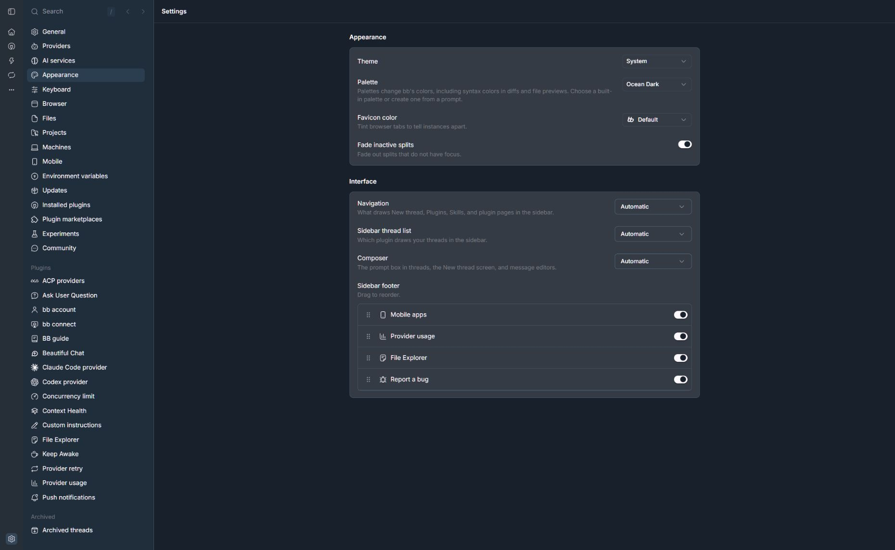
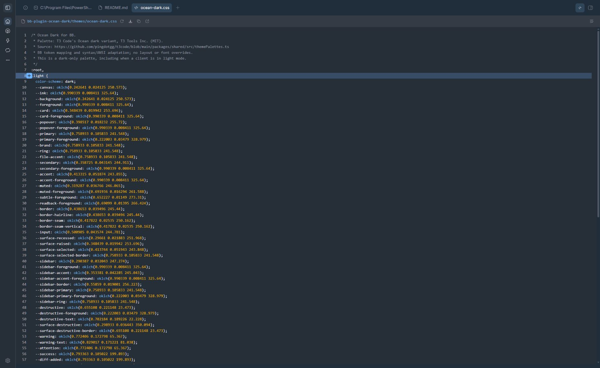

# Ocean Dark for BB

A dark theme with blue-grey surfaces, sky-blue accents, and teal highlights.
The app palette adapts T3 Code's Ocean dark theme. Code, diff, and terminal
colours are coordinated for BB.

## Screenshots

BB's Appearance settings with Ocean Dark selected:



The theme's stylesheet in BB's code preview:



## Install

After the first public release, install from GitHub:

```sh
bb plugin install git:https://github.com/Treo-Solutions/bb-plugin-ocean-dark.git@^0.1.0
```

Open **Settings → Appearance** and select **Ocean Dark**. Installing the plugin
adds the choice; it does not select it for you.

You can also select it from the terminal:

```sh
bb theme set plugin:ocean-dark:ocean-dark
```

If you already have the earlier custom theme, its ID is `ocean-dark`.
The plugin theme uses `plugin:ocean-dark:ocean-dark`; the two can coexist.

## Appearance

- Blue-grey canvas and sidebar with lighter panel and menu surfaces.
- Sky-blue buttons, links, selection, and keyboard focus.
- Teal success and addition indicators, red errors and removals, amber warnings.
- Matching syntax highlighting, diffs, file previews, and terminal colours.
- BB's existing layout, fonts, and controls.

This is a **dark-only** theme. It keeps the same palette when BB's client
appearance setting is Light, Dark, or System. Choose another theme to return
to a palette that follows the appearance mode.

## Requirements

BB 0.47.1 or later, with Plugin SDK 0.6.79 up to (but not including) 0.7.
The initial release is checked against BB 0.47.1 and SDK 0.6.79 on Windows.
No account, API key, external font, or additional service is required.

## Local development

Run from the plugin directory:

```sh
npm ci --include=dev --ignore-scripts
npm run typecheck
bb plugin build
bb plugin install .
```

Select the plugin theme in Appearance. After editing the CSS or code palette:

```sh
bb plugin reload ocean-dark
```

The stylesheet is `themes/ocean-dark.css`, and the code palette is
`themes/ocean-dark.json`. The backend factory is intentionally empty.
The plugin registers no commands, panels, settings, background services,
agent instructions, or network calls.

## Attribution and licence

MIT. The Ocean palette comes from [T3 Code](https://github.com/pingdotgg/t3code),
Copyright (c) 2026 T3 Tools Inc. The BB token mapping, syntax and ANSI colour
adaptation, and packaging are maintained by Treo-Solutions.

This is an independent adaptation and is not endorsed by T3 Tools Inc.
See [LICENSE](LICENSE) and [THIRD_PARTY_NOTICES.md](THIRD_PARTY_NOTICES.md).
